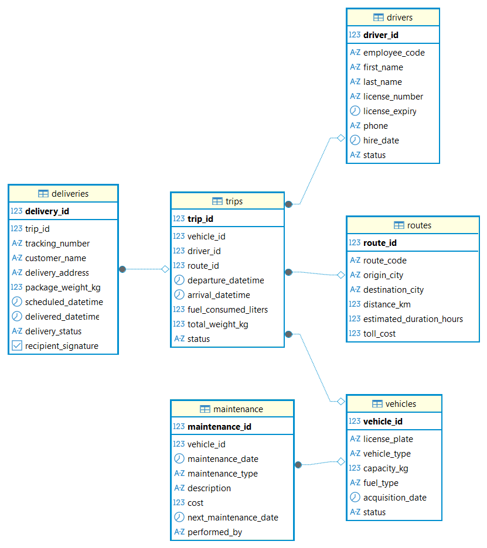
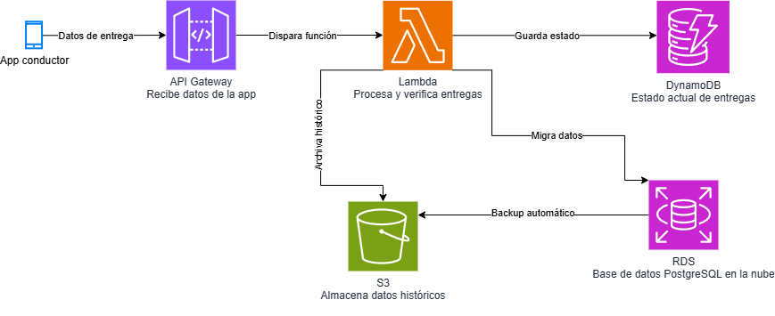

# Informe ejecutivo — Hallazgos de la operación de flota

FleetLogix · Infraestructura de datos para logística de última milla · Mauricio Melgarejo

Este informe resume, en lenguaje de negocio, los hallazgos del análisis de la operación de flota y qué decisiones habilitan. El detalle técnico está en los scripts SQL y Python de `Avance_1/` a `Avance_4/`.

---

## 1. Resumen ejecutivo

El análisis de 505.569 registros de operación (2 años, 200 vehículos, 400 conductores, 100.000 viajes) muestra un problema de puntualidad estructural, un riesgo de cumplimiento normativo activo, y una ruta con eficiencia de combustible significativamente peor que el resto.

- **El 54% de las entregas llega tarde, todos los días, sin excepción** — no hay un día ni una franja horaria donde la puntualidad mejore. Esto indica que el problema es estructural (capacidad, rutas o procesos), no una situación puntual de tráfico o clima.
- **Un conductor opera con licencia vencida desde el 22/05/2026.** Es un riesgo de cumplimiento normativo activo y debería resolverse antes que cualquier otra acción comercial.
- **La ruta Bogotá-Barranquilla es la menos eficiente en consumo de combustible** (0,116 litros/km), lo que la convierte en la primera candidata para revisión de trazado, tipo de vehículo asignado o conductor.

**Impacto esperado:** resolver el riesgo de cumplimiento es inmediato y de bajo costo. La puntualidad estructural y la eficiencia de ruta requieren una investigación más profunda, pero el tamaño del problema (más de la mitad de las entregas) sugiere que corregirlo tiene impacto directo en satisfacción del cliente y costo operativo.

---

## 2. Recomendaciones de negocio

1. **Resolver de inmediato la licencia vencida del conductor identificado** — es el único hallazgo que representa una exposición legal directa para la empresa.
2. **Investigar la causa raíz del 54% de retrasos** antes de invertir en más flota o personal: si el problema es estructural (ej. rutas mal diseñadas, ventanas de entrega poco realistas, sobrecarga de ciertos vehículos), agregar recursos sin corregir la causa no mejora la puntualidad.
3. **Auditar la ruta Bogotá-Barranquilla** específicamente: comparar vehículo, conductor y trazado contra rutas de eficiencia similar para aislar la variable responsable.
4. **Usar la migración a la nube (ver Avance 4) como oportunidad** para instrumentar alertas en tiempo real de puntualidad y vencimientos de licencia, en lugar de detectarlos en un análisis retrospectivo como este.

---

## 3. Limitaciones y supuestos

- **Los datos son sintéticos**, generados con Faker para esta práctica (no son datos operativos reales de ninguna empresa). La tasa de retrasos del 54% fue insertada deliberadamente en la generación de datos para que el ejercicio tuviera un patrón de puntualidad real para analizar — en una implementación real, este número vendría de la operación y no de un diseño de dataset.
- El pipeline ETL hacia el Data Warehouse descartó 14.995 de 33.900 registros extraídos (44%) por inconsistencias temporales (fechas de entrega anteriores a la fecha de despacho). Esa proporción de descarte es alta y, en un dataset real, sería motivo de revisión del sistema de origen, no solo del pipeline de carga.
- La arquitectura en AWS (Avance 4) es un diseño técnico, no una infraestructura desplegada — está pensada para validar el diseño, no para operar en producción tal como está.

---

## 4. Evidencia

Fuente: elaboración propia — modelo relacional de la base operativa (Avance 1).

Fuente: elaboración propia — diseño de arquitectura cloud para operación en tiempo real (Avance 4).

---

## 5. Metodología y fuentes

505.569 registros sintéticos generados con Faker (`es_CO`, seed fija) simulando 2 años de operación: 200 vehículos, 400 conductores, 48 rutas, 100.000 viajes, 400.001 entregas y 4.920 mantenimientos. Modelo relacional en PostgreSQL, análisis SQL con 12 queries de negocio, Data Warehouse dimensional en Snowflake, y diseño de arquitectura cloud en AWS. Detalle completo en los scripts de `Avance_1/` a `Avance_4/` de este repositorio.
