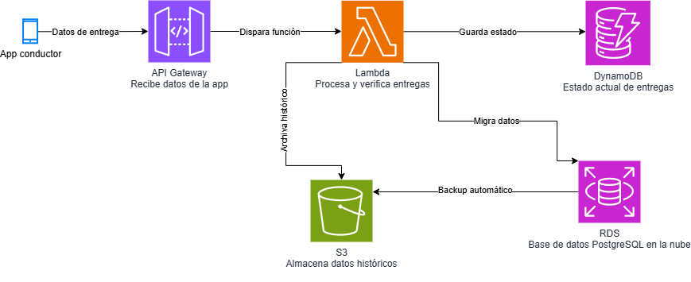

# FleetLogix — Infraestructura de Datos para Logística de Última Milla

Diseño e implementación end-to-end de la infraestructura de datos de una empresa de logística ficticia (200 vehículos, operación en 5 ciudades de Colombia), desde el modelo relacional hasta una arquitectura cloud. Módulo 2 — Soy Henry Data Science AI.

<p align="center"></p>
<p align="center"><sub>Arquitectura cloud de referencia (diseño, no desplegada) — detalle en la sección "Arquitectura cloud" más abajo.</sub></p>

## Problema de negocio

FleetLogix necesita centralizar y analizar la operación de su flota —vehículos, conductores, rutas, viajes y entregas— para detectar problemas de puntualidad y cumplimiento, optimizar las consultas analíticas que soportan esas decisiones, y migrar esa infraestructura a la nube.

## Pipeline — 4 etapas, cada una sobre la anterior

| Etapa | Contenido |
|---|---|
| 1 — Modelo relacional y generación de datos | PostgreSQL con 6 tablas interrelacionadas · generación sintética con Faker (locale colombiano, seed fija) · 505.569 registros · 5 validaciones de integridad |
| 2 — Análisis y optimización SQL | 12 queries de negocio en 3 niveles de complejidad · 5 índices de optimización, con impacto verificado caso por caso con `EXPLAIN ANALYZE` (detalle abajo) |
| 3 — Data Warehouse en Snowflake | Modelo estrella (`fact_deliveries` + 7 dimensiones) · pipeline ETL que calcula 8 métricas nuevas · filtrado de calidad y optimización de carga |
| 4 — Arquitectura cloud en AWS | Diseño con API Gateway, Lambda, DynamoDB, S3 y RDS para operación en tiempo real (diseño técnico, no desplegado) |

## Dataset

- 505.569 registros sintéticos — 2 años de operación histórica
- 200 vehículos · 400 conductores · 48 rutas · 100.000 viajes · 400.001 entregas · 4.920 mantenimientos
- Generado con Faker (`es_CO`) y seed fija para reproducibilidad; incluye distribución horaria realista, ocupación variable de vehículos y una tasa deliberada de entregas tardías para que el análisis de puntualidad tenga sentido

## Hallazgos clave

- **Cumplimiento:** un conductor opera con licencia vencida desde el 22/05/2026
- **Puntualidad:** 54% de retrasos *todos los días sin excepción* — indica un problema estructural, no situacional
- **Eficiencia de ruta:** Bogotá–Barranquilla es la ruta menos eficiente en consumo de combustible (0,116 l/km)
- **Performance SQL:** el índice sobre mantenimiento por vehículo (`idx_maintenance_vehicle_cost`) convierte el lookup puntual de costos por vehículo en un *Index Only Scan*, bajando el tiempo de ejecución ~78% (0,40 ms → 0,09 ms, promedio de varias corridas). Los índices sobre campos de estado (`status`, `delivery_status`) no mostraron mejora medible en los 12 queries documentados — ver el detalle en "Optimización de queries" abajo, incluye por qué.
- **Calidad de datos en el ETL:** de 33.900 registros extraídos, 18.905 pasaron los filtros de calidad (se descartaron 14.995 por inconsistencias temporales que habrían distorsionado el análisis)
- **Troubleshooting de performance:** la carga de clientes por `MERGE` fila por fila generaba timeout con 17.000 registros; se resolvió migrando a carga en batch, bajando el tiempo de minutos a segundos

**Informe ejecutivo** (hallazgos y recomendaciones de negocio, pensado para lectores no técnicos): [`INFORME_EJECUTIVO.md`](INFORME_EJECUTIVO.md).

## Optimización de queries: antes y después

Medición reproducible contra una base PostgreSQL local cargada con el dataset completo (505.569 filas), antes y después de aplicar `Avance_2/03_optimization_indexes.sql`.

**Caso con mejora real — lookup de mantenimiento por vehículo** (patrón de acceso típico de una pantalla de detalle de vehículo):

```sql
EXPLAIN ANALYZE
SELECT vehicle_id, SUM(cost) AS total_cost, COUNT(*) AS n
FROM maintenance
WHERE vehicle_id = 50
GROUP BY vehicle_id;
```

| | Plan | Tiempo de ejecución |
|---|---|---|
| Antes (sin índice) | `Seq Scan on maintenance` | ~0.40 ms |
| Después (`idx_maintenance_vehicle_cost`) | `Index Only Scan` (0 heap fetches) | ~0.09 ms |

**~78% más rápido**, y el plan deja de tocar la tabla completa.

**Caso honesto — por qué los otros 4 índices no se notan en los 12 queries documentados:** tres de los cinco índices (`idx_trips_composite_joins`, `idx_deliveries_scheduled_datetime`, `idx_drivers_status_license`) son índices parciales filtrados por una columna de estado (`status = 'completed'`, `delivery_status = 'delivered'`, `status = 'active'`). Verificando la distribución real de esas columnas en el dataset generado:

```sql
SELECT status, COUNT(*) FROM trips GROUP BY status;        -- completed: 100.000 (100%)
SELECT delivery_status, COUNT(*) FROM deliveries GROUP BY delivery_status;  -- delivered: 400.001 (100%)
SELECT status, COUNT(*) FROM drivers GROUP BY status;       -- active: 373 (93%)
```

El generador sintético (`Avance_1/01_data_generation.py`) no introduce variedad real en esos campos, así que el predicado del índice parcial cubre prácticamente el 100% de las filas — el optimizador de PostgreSQL correctamente elige un `Seq Scan` en vez del índice, porque no hay nada que filtrar. Repitiendo `EXPLAIN ANALYZE` de las 12 queries de `Avance_2/02_queries_analysis.sql` antes y después de crear los 5 índices, el tiempo total no cambia de forma medible para ninguna de ellas.

Esto no invalida el diseño de los índices — la lógica de negocio detrás (filtrar viajes completados, entregas entregadas, conductores activos) es correcta y sería efectiva sobre datos reales con distribución realista de estados. Es una limitación del dataset sintético, documentada aquí en vez de maquillada con una cifra de mejora que no se puede reproducir.

## Arquitectura cloud (diseño)

```
App del conductor → API Gateway → Lambda (verificación de entregas, cálculo de ETA, detección de desvíos)
                                      ├── DynamoDB   (estado en tiempo real de entregas y posiciones)
                                      ├── S3          (archivo histórico)
                                      └── RDS         (PostgreSQL administrado)
```

Diagrama completo arriba y en `Avance_4/aws_architecture_diagram.png`.

## Estructura del repositorio

| Carpeta | Contenido |
|---|---|
| `Avance_1/` | Schema SQL, script de generación de datos, diagrama ER |
| `Avance_2/` | Queries de análisis, script de índices de optimización |
| `Avance_3/` | Modelo dimensional (SQL), pipeline ETL a Snowflake |
| `Avance_4/` | Scripts de arquitectura AWS (`aws_setup.py`, `lambda_functions.py`), script de migración, diagrama de arquitectura |

## Stack

PostgreSQL · Python (psycopg2, Faker) · SQL · Snowflake (snowflake-connector-python) · pandas · NumPy · AWS — diseño (API Gateway, Lambda, DynamoDB, S3, RDS) · boto3 · draw.io

## Cómo reproducirlo

```bash
git clone https://github.com/mmelgarejo-ds/FleetLogix.git
cd FleetLogix
pip install -r requirements.txt
```

`Avance_1/01_data_generation.py` genera los datos sintéticos (requiere PostgreSQL local). Los `.sql` de `Avance_2/` y `Avance_3/` se ejecutan contra esa base. `Avance_4/aws_setup.py` y `lambda_functions.py` son diseño de infraestructura — requieren credenciales AWS propias para ejecutarse y no están pensados para correr sin una cuenta configurada.

## Autor

Mauricio Melgarejo · [LinkedIn](https://linkedin.com/in/mauricio-daniel-melgarejo-amaro-482596105) · [GitHub](https://github.com/mmelgarejo-ds)
